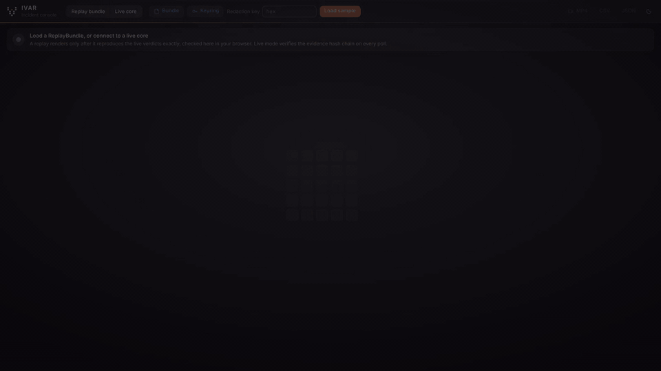
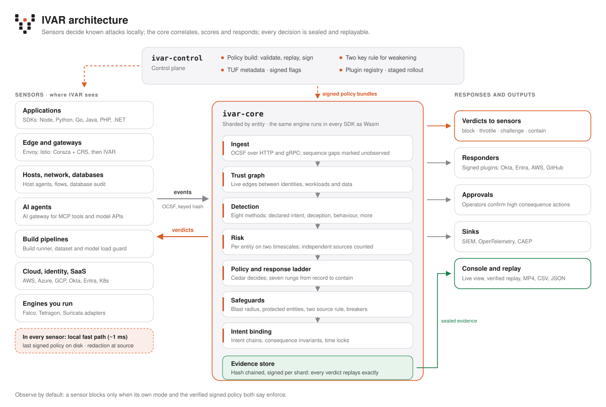
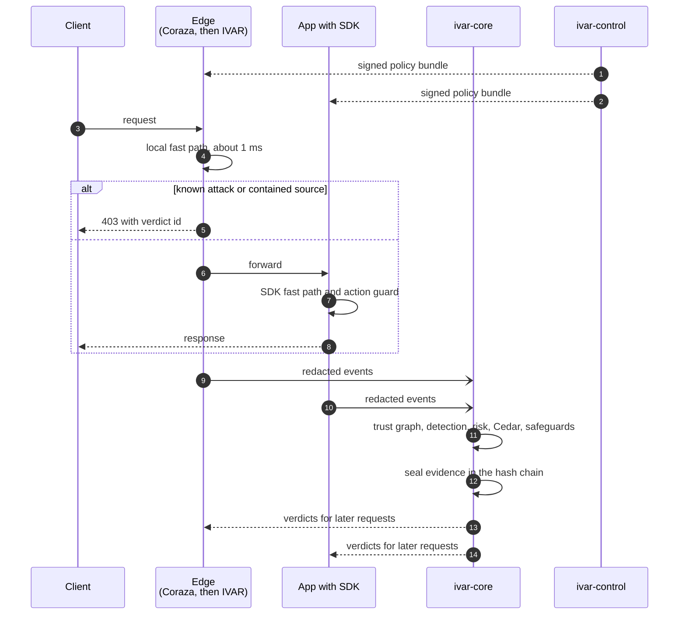
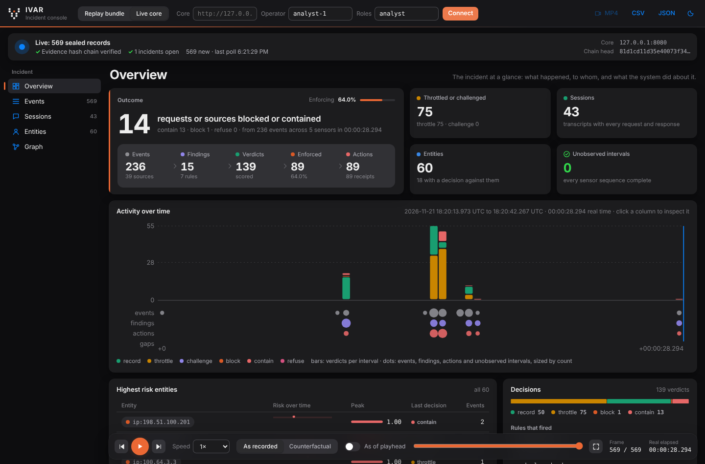
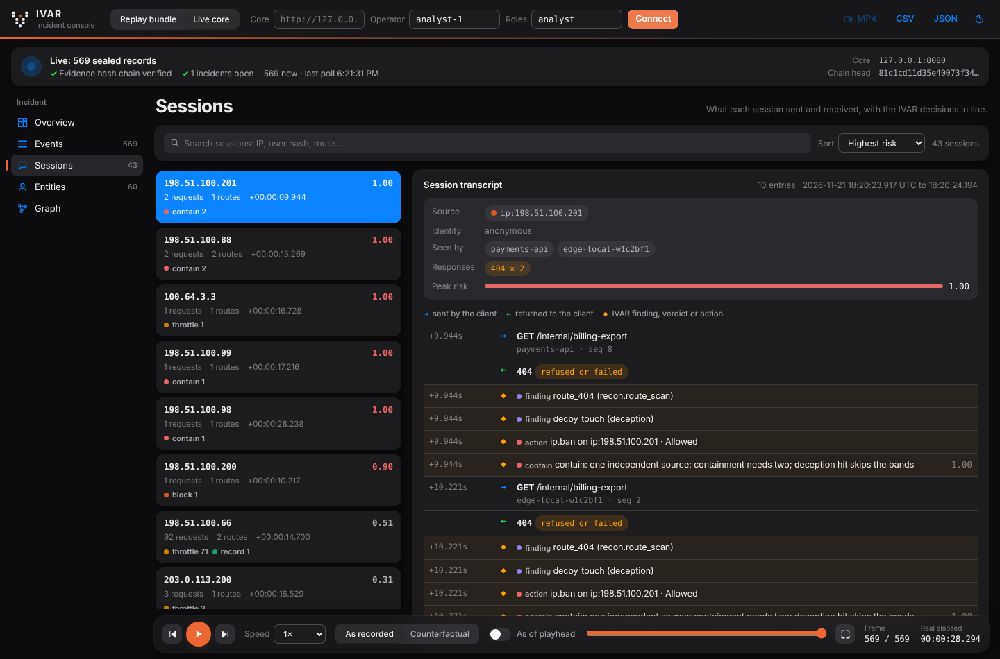
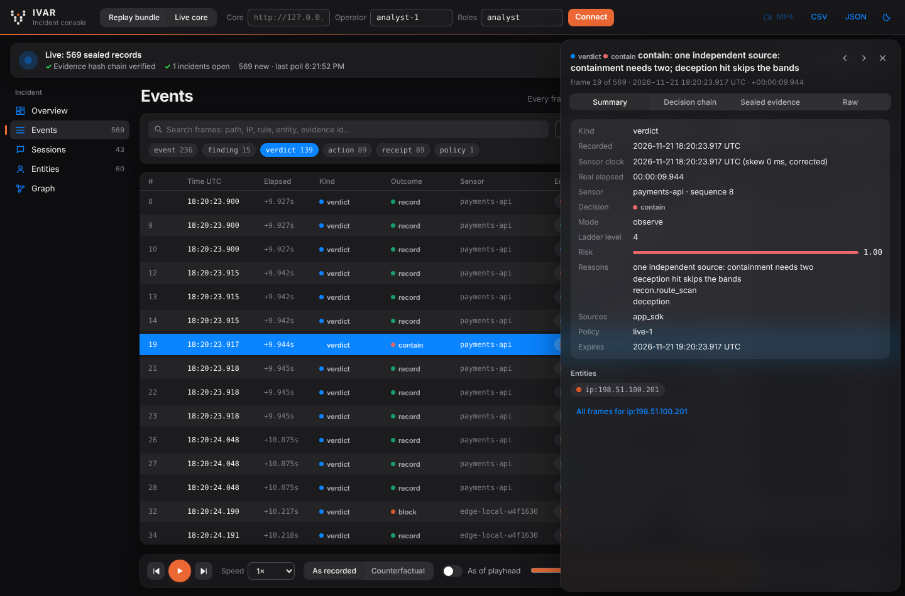

<p align="center">
  <picture>
    <source media="(prefers-color-scheme: dark)" srcset="docs/brand/ivar-logo-dark.svg">
    
  </picture>
</p>

<h3 align="center">Intent Verified Adaptive Response</h3>

<p align="center">
  Intent bound defence against agentic intrusion: every irreversible action needs a reason, every decision can be replayed.
</p>

<p align="center">
  <a href="https://github.com/jhmeel/Ivar/actions/workflows/ci.yml"></a>
  <a href="LICENSE"></a>
  
  
  
</p>

<p align="center">
  <a href="#installation">Install</a> ·
  <a href="#quick-start">Quick start</a> ·
  <a href="#architecture">Architecture</a> ·
  <a href="#integrating-ivar">Integrations</a> ·
  <a href="#the-console">Console</a> ·
  <a href="#the-live-test-replayed">Live test</a>
</p>

---

IVAR is an implementation of the design specification *Intent-Bound Defence
Against Agentic Intrusion*. It models an estate as a live graph of trust edges
between identities, workloads and data. Detections, risk and every response
act on those edges, and irreversible actions such as payouts, role changes and
bulk exports only execute with a valid intent chain behind them.

<p align="center">
  <a href="docs/media/ivar-console-walkthrough.mp4"></a>
  <br><sub>The operator console on a live attack, replayed from sealed evidence. <a href="docs/media/ivar-console-walkthrough.mp4">Watch the full walkthrough</a> (2 min, 1080p, with sound).</sub>
</p>

## Contents

- [Why IVAR](#why-ivar)
- [Architecture](#architecture)
- [Installation](#installation)
- [Quick start](#quick-start)
- [Integrating IVAR](#integrating-ivar)
- [The console](#the-console)
- [The live test, replayed](#the-live-test-replayed)
- [Repository layout](#repository-layout)
- [Operating IVAR](#operating-ivar)
- [Running at scale](#running-at-scale)
- [Specification traceability](#specification-traceability)
- [Verification status](#verification-status)
- [Contributing](#contributing)
- [License and credit](#license-and-credit)

## Why IVAR

- **A stolen credential is not a reason.** High-consequence actions run only
  with an intent chain minted where the customer's request began and attested
  by every step, so a valid session with no business reason behind it is refused.
- **One verified decision core, everywhere.** The core is written once in Rust
  and compiled to WebAssembly for every SDK and the edge filter: the decision
  in Node is byte for byte the decision in Go, PHP or Envoy.
- **Safe to switch on.** Everything installs in observe. Enforcement is signed
  runtime policy, weakening it needs two keys, and every automatic action
  passes safeguards: blast radius budgets, protected entities, shared networks
  never banned, a two-source rule and per-rule circuit breakers.
- **Evidence, not logs.** Every event and verdict is sealed in a hash chain
  signed per shard. Any incident replays deterministically, is re-verified by
  a third party, and exports as a video.
- **Works with what you run.** Coraza and the OWASP Core Rule Set at the edge;
  Falco, Tetragon and Suricata on hosts and networks; Okta, Entra, Workspace,
  GitHub and the three clouds through connectors and signed responders.

## Architecture

<p align="center">
  <picture>
    <source media="(prefers-color-scheme: dark)" srcset="docs/brand/ivar-architecture-dark.svg">
    
  </picture>
</p>

| Component | Role |
|---|---|
| **Sensors** | SDKs, the edge filter, host, network and database sensors, the AI gateway, the build runner and the connectors. Each builds OCSF events, redacts payloads and identifiers with a keyed hash at the source, and decides known attacks locally from its last signed policy. |
| **`ivar-core`** | Correlates events on the trust graph, runs the eight detection methods, scores risk, picks a response under Cedar policy and the safeguards, enforces intent binding, and seals the evidence. Sharded by entity, each shard with its own evidence chain. |
| **`ivar-control`** | Builds and signs policy after replaying the attack library against it, publishes it through TUF with signed flags, and runs the plugin registry and staged rollout. |
| **Responders and sinks** | Signed plugins carry responses into identity providers and clouds; SIEM, OpenTelemetry and CAEP sinks carry the record out. |
| **Console** | Follows a live core or verifies and replays a bundle in the browser, with MP4, CSV and JSON export. |

### How a request is decided



1. A sensor builds an OCSF event with the `ivar` extension and redacts
   payloads and identifiers with a keyed hash before anything leaves it.
2. The sensor's local fast path decides known attacks from its last signed
   policy in about a millisecond; everything else is forwarded.
3. The core correlates the event on the trust graph, runs the eight methods,
   and scores each entity on two timescales (30-minute and 7-day half-lives)
   with rule family maxima and independent sources.
4. Risk bands (0.30, 0.60, 0.85) pick a rung on the seven-level ladder; every
   automatic action passes the safeguards (blast radius budget split by
   confidence class, protected entities, shared networks never banned, two
   source rule, per-rule circuit breaker, evidence first, reversal, actor not
   target) and Cedar.
5. Evidence is sealed in a hash chain signed per shard, so any verdict can be
   replayed deterministically from its evidence and policy version.

DETECTION_MODE is signed runtime policy. A sensor blocks only when its own
mode and the verified policy both say enforce, so a sensor installed in
observe for rollout phase 1 never blocks, and a signed observe policy stops
every sensor from blocking with no deploy.

## Installation

Everything is published from this repository: there is nothing to install
from npm, PyPI, Maven Central, Packagist or NuGet. Each tagged version has a
[GitHub Release](https://github.com/jhmeel/Ivar/releases) with every package,
the binaries and the WebAssembly modules (with a `SHA256SUMS` file), and
container images in GitHub's registry under `ghcr.io/jhmeel/ivar`.

| Component | Install |
|---|---|
| Node.js SDK | `npm install https://github.com/jhmeel/Ivar/releases/download/v0.1.1/ivar-express-0.1.1.tgz` |
| Python SDK | `pip install https://github.com/jhmeel/Ivar/releases/download/v0.1.1/ivar-0.1.1-py3-none-any.whl` |
| Go SDK | `go get github.com/jhmeel/ivar/sdk/go@v0.1.1` |
| Java SDK | the jar and pom from the release, installed into your local Maven repository (below) |
| PHP SDK | the zip from the release, through a Composer `package` repository (below) |
| .NET SDK | the `.nupkg` from the release, added from a local folder (below) |
| Core, control plane, connectors, sensors | `docker pull ghcr.io/jhmeel/ivar/core:v0.1.1` (also `control`, `connectors`, `sensors`) |
| Edge filter for Envoy and Istio | `ghcr.io/jhmeel/ivar/edge-filter:v0.1.1`, or `ivar_edge_filter.wasm` from the release |
| Linux binaries | `ivar-0.1.1-linux-x86_64.tar.gz` from the release |

Verify what you download:

```bash
curl -LO https://github.com/jhmeel/Ivar/releases/download/v0.1.1/SHA256SUMS
sha256sum --check --ignore-missing SHA256SUMS
```

The Python SDK also installs straight from git, without a release:
`pip install "ivar @ git+https://github.com/jhmeel/Ivar.git@v0.1.1#subdirectory=sdk/python"`.

**Java**, with Maven or Gradle:

```bash
curl -LO https://github.com/jhmeel/Ivar/releases/download/v0.1.1/ivar-java-0.1.1.jar -LO https://github.com/jhmeel/Ivar/releases/download/v0.1.1/ivar-java-0.1.1.pom
mvn install:install-file -Dfile=ivar-java-0.1.1.jar -DpomFile=ivar-java-0.1.1.pom
```

then depend on `dev.ivar:ivar-java:0.1.1` (Gradle: add `mavenLocal()` to the
repositories). Its own dependencies resolve from Maven Central as usual.

**PHP**, in `composer.json`:

```json
{
  "repositories": [{
    "type": "package",
    "package": {
      "name": "ivar/ivar-php",
      "version": "0.1.1",
      "dist": { "url": "https://github.com/jhmeel/Ivar/releases/download/v0.1.1/ivar-php-0.1.1.zip", "type": "zip" },
      "require": { "php": ">=8.1", "ext-ffi": "*", "ext-json": "*" },
      "autoload": { "psr-4": { "Ivar\\": "src/" } }
    }
  }],
  "require": { "ivar/ivar-php": "0.1.1" }
}
```

**.NET**:

```bash
mkdir -p packages
curl -L -o packages/Ivar.AspNetCore.0.1.1.nupkg https://github.com/jhmeel/Ivar/releases/download/v0.1.1/Ivar.AspNetCore.0.1.1.nupkg
dotnet new nugetconfig
dotnet nuget add source ./packages --name ivar-release --configfile nuget.config
dotnet add package Ivar.AspNetCore --version 0.1.1
```

The folder is added next to nuget.org, which still serves the SDK's own
dependencies.

**From source**: `scripts/build-wasm.sh` builds the core for every SDK, and
each SDK then builds in place (`sdk/<language>`). Releases are made by
`.github/workflows/release.yml` when a `v*` tag is pushed.

## Quick start

```bash
scripts/build-wasm.sh                 # core to WebAssembly for the SDKs and viewer
cargo test --workspace                # Rust
deploy/local/up.sh                    # core, control plane, upstream, Envoy with the IVAR filter
python3 deploy/local/smoke_test.py    # end to end through real Envoy
deploy/local/up.sh down
```

Replay any incident from sealed evidence, then export it as a video (the
bundle is verified before a frame is drawn):

```bash
ivar-core replay --evidence data/evidence-0.jsonl --policies data/policies-0 --keyring keyring.json --redaction keys/redaction.hex --signer keys/evidence-0.seed --out replay.json
node scripts/export-replay.cjs replay.json keyring.json keys/redaction.hex replay.mp4
```

With Coraza and the OWASP Core Rule Set ahead of the IVAR filter:

```bash
CORAZA_WASM=/path/to/coraza-proxy-wasm.wasm deploy/local/up.sh && python3 deploy/local/smoke_test.py
```

A live test: installs from the release images in front of a real Express
payments API using the SDK, then runs legitimate traffic and an attack
campaign (credential spray, account takeover, mass assignment, payout
without intent, time-locked payout, decoys, victim lockout, shared
networks), forensics (incidents, evidence chain, signed replay re-verified
by a third party) and resilience (control plane down, core down, restart):

```bash
CORAZA_WASM=/path/to/coraza-proxy-wasm.wasm deploy/live/up.sh && python3 deploy/live/attack.py
deploy/live/up.sh down
```

See [Integrating IVAR](#integrating-ivar) for every SDK, gateway, sensor and connector.

## Integrating IVAR

IVAR has one decision core and many ways to feed it. Every sensor (SDK,
gateway filter, host agent, connector) sends OCSF events to the core, keeps
the last signed policy on disk, and decides known attacks locally in about a
millisecond. Everything starts in **observe**: nothing blocks until a signed
policy says enforce *and* the component's own mode allows it.

### Where to start

| You run | Install | Section |
|---|---|---|
| A web app or API | The SDK for its framework | [Application SDKs](#application-sdks) |
| Envoy, Istio, or a Proxy-Wasm gateway | The edge filter, with Coraza ahead of it | [Gateways and the edge](#gateways-and-the-edge) |
| Kubernetes | The Helm chart (core, control plane, node agent, gateway plugin) | [Kubernetes](#kubernetes) |
| Docker Compose | One extra Compose file | [Docker Compose](#docker-compose) |
| Linux or Windows hosts, networks, databases | The host, network and database sensors | [Host, network and database sensors](#host-network-and-database-sensors) |
| AI agents, MCP servers, model APIs | The AI gateway | [AI agents](#ai-agents-and-mcp-tools) |
| CI runners and package installs | The build runner and the Python pipeline sensor | [Build pipelines](#build-pipelines-and-the-supply-chain) |
| Cloud accounts, Okta, Entra, Workspace, GitHub, Salesforce | `ivar-connector` and the Terraform modules | [Cloud and identity](#cloud-identity-and-saas-connectors) |
| Falco, Tetragon or Suricata already | The adapter endpoint | [Engines you already run](#engines-you-already-run) |
| Anything else | Post events to the core | [Custom sensors](#custom-sensors) |

### Run the core and the control plane

Every integration talks to `ivar-core` (events, verdicts, evidence) and,
optionally, `ivar-control` (signed policy, flags, plugins). The release
download has everything these steps need: the binaries in `bin/`, a starter
policy in `share/ivar/policy/`, the attack replay library and the console.

```bash
curl -LO https://github.com/jhmeel/Ivar/releases/download/v0.1.1/ivar-0.1.1-linux-x86_64.tar.gz
tar -xzf ivar-0.1.1-linux-x86_64.tar.gz && cd ivar-0.1.1-linux-x86_64
export PATH="$PWD/bin:$PATH"
cp share/ivar/policy/*.yaml .     # policy.yaml, openapi.yaml, time-locks.yaml, operator-decisions.yaml

# Keys: one seed file per key; the key id is the file name.
ivar-core keygen keys/policy-a.seed
ivar-core keygen keys/policy-b.seed
ivar-core keygen keys/evidence.seed
ivar-core keygen keys/action.seed
head -c 32 /dev/urandom | od -An -tx1 | tr -d ' \n' > keys/redaction.hex

# The keyring sensors use to verify policy (weakening needs both policy keys).
ivar-core keyring keyring.json keys/policy-a.seed=policy keys/policy-b.seed=policy

# Validate the policy against the attack replay library, then sign it.
ivar-control validate --source policy.yaml
ivar-control build --source policy.yaml --keys keys/policy-a.seed,keys/policy-b.seed --out policy.bundle
```

Edit `policy.yaml` and `openapi.yaml` to describe your own API before you
sign it; the starter declares a small payments API.

`core.yaml`:

```yaml
http_listen: 0.0.0.0:8080
grpc_listen: 0.0.0.0:7443
data_dir: /var/lib/ivar
policy_bundle: /etc/ivar/policy.bundle
keyring: /etc/ivar/keyring.json
evidence_key_seed_file: /etc/ivar/keys/evidence.seed
action_key_seed_file: /etc/ivar/keys/action.seed
redaction_key_hex_file: /etc/ivar/keys/redaction.hex
public_url: https://ivar.internal
expected_layers: [edge, app_sdk, host, network, database]
# The operator console is served at /console/ by default; console_dir: "" turns it off.
```

Run it from the download, with the paths in `core.yaml` pointing at the
files above (it serves the console from `share/ivar/console`):

```bash
ivar-core serve --config core.yaml
```

or with the image, which reads them from `/etc/ivar`:

```bash
docker run -d --name ivar-core -p 8080:8080 -v "$PWD:/etc/ivar:ro" -v ivar-evidence:/var/lib/ivar \
  ghcr.io/jhmeel/ivar/core:v0.1.1 serve --config /etc/ivar/core.yaml
```

The redaction key is shared with every sensor: payload values and
identifiers are replaced by keyed hashes before anything leaves the sensor.

### Application SDKs

Every SDK embeds the same verified core compiled to WebAssembly, so a
decision made in Node is byte for byte the decision made in Go or PHP. Each
one does the same four things:

1. **Middleware** on every request: local fast path decision, event to the
   core after the response, core verdicts applied to later requests.
2. **Reports** for logins and business actions, so spraying, takeover and
   abuse of a valid session can be correlated.
3. **Action guards** on high-consequence routes (payouts, role changes,
   exports): intent binding, consequence invariants and time locks.
4. **Failure behaviour**: faults fail open on public routes, within a
   budget, and fail closed on admin routes (`/admin` by default).

| Language | Package | Frameworks |
|---|---|---|
| Node.js | `@ivar/express` | Express 4 and 5 |
| Python | `ivar` | FastAPI, Starlette and any ASGI app; Flask, Django and any WSGI app |
| Go | `github.com/jhmeel/ivar/sdk/go` | `net/http` and every router that takes an `http.Handler` (chi, gorilla, echo, gin through adapters) |
| Java | `dev.ivar:ivar-java` | Spring Boot, Jakarta EE, any Servlet container |
| PHP | `ivar/ivar-php` | Laravel, or any PHP app through `Guardian` |
| .NET | `Ivar.AspNetCore` | ASP.NET Core |

#### Node.js (Express)

```bash
npm install https://github.com/jhmeel/Ivar/releases/download/v0.1.1/ivar-express-0.1.1.tgz
```

```js
const express = require('express');
const fs = require('node:fs');
const { ivar, mintIntent, attestStep, stepPublicKey, INTENT_HEADER } = require('@ivar/express');

const mw = ivar({
  mode: 'observe',                                   // 'enforce' once the rollout allows it
  identity: (req) => req.user?.id,
  session: (req) => req.sessionID,
  roles: (req) => req.user?.roles ?? [],
  tenant: (req) => req.user?.orgId,
  coreUrl: process.env.IVAR_CORE_URL,                 // http://ivar-core:8080
  controlUrl: process.env.IVAR_CONTROL_URL,           // signed policy updates, no restart
  policyBundle: fs.readFileSync('policy.bundle', 'utf8'),
  policyKeyring: JSON.parse(fs.readFileSync('keyring.json', 'utf8')),
  policyStateFile: '/var/lib/myapp/ivar-policy.bundle', // last verified policy survives restarts
  redactionKey: fs.readFileSync('redaction.hex', 'utf8').trim(),
  sensorId: 'payments-api',
  adminPrefixes: ['/admin', '/internal'],
  onAlert: (a) => logger.warn({ ivar: a.kind }, a.message),
});

const app = express();
app.set('trust proxy', ['loopback', '10.0.0.0/8']);   // the real client IP, not the gateway's
app.use(express.json());
app.use(mw);

// Report logins so credential spraying and account takeover are correlated.
app.post('/login', async (req, res) => {
  const ok = await checkPassword(req.body.email, req.body.password);
  req.ivar.login({ success: ok, account: req.body.email });
  if (!ok) return res.status(401).end();
  res.json({ session: await startSession(req.body.email) });
});

// Report business actions that are not money movements.
app.post('/exports', (req, res) => {
  req.ivar.action('customer_export', { records: req.body.ids.length });
  res.json(runExport(req.body.ids));
});

// Guard a high-consequence action with an intent chain (section 6.2).
const stepKeys = { authenticated_session: process.env.STEP_SESSION_PUB, ledger_entry: process.env.STEP_LEDGER_PUB, payout_instruction: process.env.STEP_PAYOUT_PUB };
app.post('/payouts',
  mw.guard('payout', { rootPublicKey: process.env.INTENT_ROOT_PUB, stepKeys }, { value: (req) => Number(req.body.amount) }),
  (req, res) => res.json(sendPayout(req.body)));

app.get('/ivar/policy', (_req, res) => res.json(mw.policy())); // which signed policy is in force
```

Issuing the intent chain the guard checks: the service that receives the
customer's request mints it, each step attests it with its own key, and the
token travels in the `Ivar-Intent` header to the sink.

```js
let { token, rootPublicKey } = mintIntent(ROOT_SEED, `int_${id}`, 'payout', sessionId, { amount: 500 });
token = attestStep(SESSION_STEP_SEED, 'authenticated_session', token, rootPublicKey); // auth service
token = attestStep(LEDGER_STEP_SEED, 'ledger_entry', token, rootPublicKey);           // ledger service
token = attestStep(PAYOUT_STEP_SEED, 'payout_instruction', token, rootPublicKey);     // payout service
await fetch('https://payments/payouts', { method: 'POST', headers: { [INTENT_HEADER]: token }, body });
// stepPublicKey(seed) gives the public key each sink is configured with.
```

A valid credential with no business reason behind it is refused; a payout
over the intent's limit is refused; one over a time-lock threshold is held
with a cancellation window.

#### Python (FastAPI, Starlette, any ASGI app)

```bash
pip install https://github.com/jhmeel/Ivar/releases/download/v0.1.1/ivar-0.1.1-py3-none-any.whl
```

```python
import json
from fastapi import FastAPI, Request
from fastapi.responses import JSONResponse
from ivar import INTENT_HEADER, verify_policy_bundle
from ivar.asgi import IvarMiddleware

policy = verify_policy_bundle(open("policy.bundle").read(), json.load(open("keyring.json")))

app = FastAPI()
app.add_middleware(
    IvarMiddleware,
    mode="observe",
    identity=lambda scope: scope.get("state", {}).get("user_id"),
    session=lambda scope: dict(scope["headers"]).get(b"x-session", b"").decode() or None,
    roles=lambda scope: scope.get("state", {}).get("roles", []),
    policy=policy,
    core_url="http://ivar-core:8080",
    redaction_key=open("redaction.hex").read().strip(),
    sensor_id="orders-api",
    admin_prefixes=("/admin",),
)

@app.post("/login")
async def login(request: Request):
    guardian, info = request.scope["state"]["ivar"]
    body = await request.json()
    ok = check_password(body["email"], body["password"])
    guardian.report_login(info, success=ok, account=body["email"])
    return {"ok": ok}

payout_guard = None

@app.post("/payouts")
async def payout(request: Request):
    global payout_guard
    guardian, info = request.scope["state"]["ivar"]
    payout_guard = payout_guard or guardian.sink("payout", ROOT_PUBLIC_KEY, STEP_KEYS)
    body = await request.json()
    d = payout_guard.check(info, request.headers.get(INTENT_HEADER), value=body["amount"])
    if d.action != "allow":
        return JSONResponse(d.body or {}, status_code=d.status)
    return send_payout(body)
```

#### Python (Flask, Django, any WSGI app)

```python
from ivar.wsgi import IvarWSGIMiddleware

# Flask
app.wsgi_app = IvarWSGIMiddleware(app.wsgi_app, mode="observe",
                                  identity=lambda environ: environ.get("REMOTE_USER"),
                                  core_url="http://ivar-core:8080", sensor_id="flask-app")

# Django: wsgi.py
application = IvarWSGIMiddleware(get_wsgi_application(), mode="observe", core_url="http://ivar-core:8080", sensor_id="django-app")
```

The `Guardian` behind both middlewares can be used directly for anything
that is not HTTP (queues, RPC, CLIs): `Guardian.inspect(RequestInfo(...))`
returns the decision, `report_login`, `report_action` and `sink(...)` work
as above.

#### Go (net/http)

```bash
go get github.com/jhmeel/ivar/sdk/go@v0.1.1
```

```go
package main

import (
	"log"
	"net/http"
	"os"
	"strconv"

	ivar "github.com/jhmeel/ivar/sdk/go"
)

func main() {
	mw, err := ivar.New(ivar.Options{
		Mode:          "observe",
		Identity:      func(r *http.Request) string { return userID(r) },
		Session:       func(r *http.Request) string { return r.Header.Get("X-Session") },
		Roles:         func(r *http.Request) []string { return roles(r) },
		CoreURL:       os.Getenv("IVAR_CORE_URL"),
		Policy:        verifiedPolicy(), // ivar.VerifyPolicyBundle(rt, bundleBase64, keyring, 0)
		RedactionKey:  os.Getenv("IVAR_REDACTION_KEY"),
		SensorID:      "ledger-api",
		AdminPrefixes: []string{"/admin"},
		OnAlert:       func(kind, msg string) { log.Printf("ivar %s: %s", kind, msg) },
	})
	if err != nil {
		log.Fatal(err)
	}
	defer mw.Close()

	mux := http.NewServeMux()
	mux.HandleFunc("POST /login", func(w http.ResponseWriter, r *http.Request) {
		ok := checkPassword(r)
		mw.ReportLogin(r, ok, r.FormValue("email"))
	})
	payout, err := mw.Guard("payout", rootPublicKey, stepKeys, ivar.GuardOptions{
		Value: func(r *http.Request) float64 { v, _ := strconv.ParseFloat(r.FormValue("amount"), 64); return v },
	}, http.HandlerFunc(sendPayout))
	if err != nil {
		log.Fatal(err)
	}
	mux.Handle("POST /payouts", payout)

	http.ListenAndServe(":8000", mw.Handler(mux)) // chi: r.Use(mw.Handler); gin: gin.WrapH
}
```

Intent tokens in Go: `ivar.MintIntent`, `ivar.AttestStep`,
`ivar.StepPublicKey`, header `ivar.IntentHeader`.

#### Java (Spring Boot, Jakarta EE, any Servlet container)

After installing the jar from the release (see [Installation](#installation)):

```xml
<dependency>
  <groupId>dev.ivar</groupId>
  <artifactId>ivar-java</artifactId>
  <version>0.1.1</version>
</dependency>
```

```java
@Configuration
class IvarConfig {
    @Bean
    IvarFilter ivarFilter() {
        IvarFilter.Options o = new IvarFilter.Options();
        o.mode = "observe";
        o.identity = r -> r.getUserPrincipal() == null ? null : r.getUserPrincipal().getName();
        o.session = r -> r.getHeader("X-Session");
        o.roles = r -> roles(r);
        o.coreUrl = System.getenv("IVAR_CORE_URL");
        o.policy = Ivar.verifyPolicyBundle(IvarRuntime.shared(), bundleBase64, keyring, 0);
        o.redactionKey = System.getenv("IVAR_REDACTION_KEY");
        o.sensorId = "accounts-service";
        o.adminPrefixes = List.of("/admin", "/actuator");
        return new IvarFilter(o);
    }

    @Bean
    FilterRegistrationBean<IvarFilter> ivarRegistration(IvarFilter f) {
        FilterRegistrationBean<IvarFilter> reg = new FilterRegistrationBean<>(f);
        reg.setOrder(Ordered.HIGHEST_PRECEDENCE + 10); // after the security filter that sets the principal
        return reg;
    }
}

@RestController
class PayoutController {
    private final ActionGuard guard;

    PayoutController(IvarFilter ivar) {
        this.guard = ivar.guard("payout", ROOT_PUBLIC_KEY, STEP_KEYS, null);
    }

    @PostMapping("/payouts")
    void payout(@RequestBody Payout p, HttpServletRequest req, HttpServletResponse res) throws IOException {
        if (!guard.check(req, res, p.amount(), 0, false)) return; // the guard wrote 403, 409 or 202
        payouts.send(p);
    }
}
```

On plain Jakarta EE register the same filter in `web.xml` or with
`ServletContext.addFilter`. Intent tokens: `Ivar.mintIntent`,
`Ivar.attestStep`, `Ivar.stepPublicKey`, header `IvarFilter.INTENT_HEADER`.

#### PHP (Laravel, or any PHP app)

Add the release as a Composer package repository (see [Installation](#installation)), then:

```bash
composer require ivar/ivar-php:0.1.1
```

The SDK runs the core with wasmtime through FFI: enable `ffi.enable=1` and
install the wasmtime C API version pinned in `composer.json`.

```php
// app/Providers/AppServiceProvider.php
use Ivar\Guardian;
use Ivar\VerdictCache;

public function register(): void
{
    $this->app->singleton(Guardian::class, fn () => new Guardian([
        'mode' => 'observe',
        'core_url' => env('IVAR_CORE_URL'),
        'policy' => \Ivar\Ivar::verifyPolicyBundle(file_get_contents(base_path('policy.bundle')), file_get_contents(base_path('keyring.json'))),
        'redaction_key' => trim(file_get_contents(base_path('redaction.hex'))),
        'sensor_id' => 'shop',
        'admin_prefixes' => ['/admin', '/nova'],
        'verdict_cache' => new VerdictCache(storage_path('ivar-verdicts.json')), // APCu when enabled
    ]));
}

// bootstrap/app.php
->withMiddleware(fn ($middleware) => $middleware->append(\Ivar\Laravel\IvarMiddleware::class))
```

```php
// A guarded action in a controller.
public function payout(Request $request, Guardian $ivar)
{
    $info = \Ivar\Laravel\IvarMiddleware::info($request);
    $d = $ivar->guard('payout', ROOT_PUBLIC_KEY, STEP_KEYS)
              ->check($info, $request->header('Ivar-Intent'), (float) $request->input('amount'));
    if ($d['action'] !== 'allow') {
        return response()->json($d['body'] ?? [], $d['status']);
    }
    return $this->payouts->send($request->all());
}
```

Without Laravel: build the request array yourself (`method`, `path`, `ip`,
`headers`, `identity`, `session`, `body_keys`), call
`$guardian->inspect($info)` before your handler and
`$guardian->report($guardian->event($info, 'http.request', 4002, $status))`
after it. PHP workers share no memory, so core verdicts are kept in APCu or
a small file and applied by every worker.

#### .NET (ASP.NET Core)

With the release package added as a source (see [Installation](#installation)):

```bash
dotnet add package Ivar.AspNetCore --version 0.1.1
```

```csharp
using Ivar;

var builder = WebApplication.CreateBuilder(args);
builder.Services.AddIvar(o =>
{
    o.Mode = "observe";
    o.Identity = ctx => ctx.User.Identity?.Name;
    o.Session = ctx => ctx.Request.Headers["X-Session"];
    o.CoreUrl = builder.Configuration["Ivar:CoreUrl"];
    o.PolicyJson = IvarApi.VerifyPolicyBundle(new IvarRuntime(), bundleBase64, keyringJson, 0);
    o.RedactionKey = builder.Configuration["Ivar:RedactionKey"]!;
    o.SensorId = "billing-api";
    o.AdminPrefixes = ["/admin"];
});

var app = builder.Build();
app.UseAuthentication();
app.UseIvar();          // after authentication, so the identity is known

var payoutGuard = app.Services.GetRequiredService<IvarGuardian>().Guard("payout", rootPublicKey, stepKeys);
app.MapPost("/payouts", async (HttpContext ctx, Payout p) =>
{
    if (!await payoutGuard.CheckAsync(ctx, value: p.Amount)) return Results.Empty; // the guard wrote the response
    return Results.Ok(await payouts.SendAsync(p));
});
app.Run();
```

#### Policy updates without a restart

Point an SDK at the control plane and it polls for newer signed policy,
verifies it against the keyring (a forged, older or expired bundle is
refused with a `policy_rejected` alert and the current policy stays), and
applies it while the application runs. Cached verdicts carry over. The last
verified policy is saved to a state file, so a restart during a control
plane outage resumes at it.

| SDK | Control plane | Keyring | Poll period | State file |
|---|---|---|---|---|
| Node.js | `controlUrl` | `policyKeyring` | `policyRefreshMs` | `policyStateFile` |
| Python | `control_url` | `policy_keyring` | `policy_refresh_s` | `policy_state_file` |
| Go | `ControlURL` | `PolicyKeyring` | `PolicyRefresh` | `PolicyStateFile` |
| Java | `controlUrl` | `policyKeyring` | `policyRefreshMillis` | `policyStateFile` |
| .NET | `ControlUrl` | `PolicyKeyringJson` | `PolicyRefresh` | `PolicyStateFile` |
| PHP | `control_url` | `policy_keyring` | `policy_refresh_s` | `policy_state_file` |

PHP serves each request from a fresh process, so it checks the control
plane at most once per period across all workers and keeps the result in
the state file; set `policy_state_file` there.

### Gateways and the edge

The edge filter is a Proxy-Wasm module (`ivar_edge_filter.wasm`, also the
`ghcr.io/jhmeel/ivar/edge-filter` OCI image). Run Coraza with the OWASP Core Rule
Set ahead of it: Coraza catches known payloads, IVAR decides on identity,
intent and behaviour, and reads Coraza's matches as one more signal.

#### Envoy

The reference config is `deploy/envoy/envoy.yaml`
(`deploy/envoy/generate.py` writes it with your keys). The filter chain:

```yaml
http_filters:
  - name: coraza
    typed_config:
      '@type': type.googleapis.com/envoy.extensions.filters.http.wasm.v3.Wasm
      config:
        name: coraza
        vm_config: { runtime: envoy.wasm.runtime.v8, code: { local: { filename: /etc/envoy/coraza-proxy-wasm.wasm } } }
  - name: ivar
    typed_config:
      '@type': type.googleapis.com/envoy.extensions.filters.http.wasm.v3.Wasm
      config:
        name: ivar
        root_id: ivar
        configuration:
          '@type': type.googleapis.com/google.protobuf.StringValue
          value: |
            {"sensor_id": "edge-1", "mode": "observe", "redaction_key_hex": "<redaction.hex>",
             "fail_open_budget_pct": 0.1, "admin_prefixes": ["/admin"], "max_body_bytes": 65536,
             "core_cluster": "ivar_core", "core_authority": "ivar-core",
             "control_cluster": "ivar_control", "control_authority": "ivar-control",
             "keyring": <keyring.json>, "policy_bundle_base64": "", "tick_ms": 500, "max_outbox": 10000}
        vm_config: { runtime: envoy.wasm.runtime.v8, code: { local: { filename: /etc/envoy/ivar_edge_filter.wasm } } }
  - name: envoy.filters.http.router
```

with `ivar_core` and `ivar_control` clusters pointing at the core and the
control plane. The filter fetches a signed bundle from the control plane;
until one verifies, admin routes fail closed. Public routes pass for the
first ten seconds after Envoy starts, so a rolling restart does not
throttle customers, then fail open within the budget. Set
`policy_bundle_base64` to start enforcing from the first request.

#### Istio

The Helm chart's `gateway.mode: istio` installs two `WasmPlugin` resources
on the ingress gateway: Coraza in the `AUTHN` phase and the IVAR filter
after it. `gateway.mode: envoyfilter` patches with `EnvoyFilter` instead.

```bash
helm install ivar deploy/helm/ivar -n ivar \
  --set gateway.mode=istio --set gateway.selector.istio=ingressgateway \
  --set-file gateway.keyringJson=keyring.json \
  --set-file gateway.policyBundle=policy.bundle \
  --set gateway.redactionKeyHex="$(cat redaction.hex)"
```

#### Other Proxy-Wasm hosts

Kong, APISIX and NGINX (with a Proxy-Wasm module) load the same
`ivar_edge_filter.wasm` with the same JSON configuration; the core and
control plane are reached as upstreams. These hosts have not been run in
this repository's tests (see [Verified here](#verification-status)).

### Kubernetes

The chart deploys the core (one shard per replica, each with its own
evidence chain), the control plane, the node agent DaemonSet, the
connectors, the admission webhook and the gateway plugin, with network
policies between them. Create the secrets first:

```bash
kubectl create ns ivar
kubectl -n ivar create secret generic ivar-keys --from-file=keys/evidence.seed --from-file=keys/action.seed \
  --from-file=keys/redaction.hex --from-file=keys/flags-1.seed --from-file=keys/cosign.pub --from-file=keys/operators.json
kubectl -n ivar create secret generic ivar-tuf --from-file=tuf/
kubectl -n ivar create secret generic ivar-policy --from-file=policy.bundle --from-file=keyring.json
helm install ivar deploy/helm/ivar -n ivar -f my-values.yaml
```

Key values: `core.replicas`, `core.expectedLayers`, `agent.mode`
(`native` scans `/proc`; `tetragon` reads Tetragon's export and applies
generated TracingPolicies), `agent.sensorMode`, `gateway.mode`
(`istio`, `envoyfilter`, `none`), `gateway.coraza.enabled`. Applications in
the cluster point their SDK at `http://ivar-core.ivar:8080`.

### Docker Compose

```bash
docker compose -f docker-compose.yaml -f deploy/compose/docker-compose.ivar.yaml up -d
```

This adds one `ivar` service and an `ivar` network with no application
change. Join each application service to the network and point its SDK or
sensor at `http://ivar:8080`. `./ivar` holds `core.yaml`, `keyring.json`,
`policy.bundle` and `keys/`.

### Host, network and database sensors

Every sensor reads the same YAML config:

```yaml
sensor_id: web-01
sensor_type: host
mode: observe                       # enforce only after the rollout allows it
core_url: http://ivar-core:8080
control_url: http://ivar-control:8090
keyring_file: /etc/ivar/keyring.json
redaction_key_hex: <redaction.hex>
state_dir: /var/lib/ivar-sensor     # the last verified policy and the outbox
buffer_capacity: 10000
flush_ms: 500
heartbeat_ms: 10000
```

| Sensor | Run it | What it sees and does |
|---|---|---|
| Linux host | `ivar-linux-agent --config c.yaml --mode native` or `--mode tetragon --tetragon-export /var/run/cilium/tetragon/tetragon.log` | Process starts (a shell under a web server), credential files, persistence; kills or isolates in enforce |
| Windows host | `ivar-windows-agent --config c.yaml` | The same on Windows (type checked, not yet run on Windows) |
| Network | `ivar-network-sensor --config c.yaml --interface eth0`, `--eve /var/log/suricata/eve.json`, or `--inline` | Flows, DNS, beacons, lateral movement; Suricata alerts as signals |
| Database | `ivar-database-sensor --config c.yaml audit pgaudit /var/log/postgresql/audit.log` (also `mysql`, `mongodb`, `mssql`) | Bulk reads and privilege changes from audit logs |
| PostgreSQL proxy | `ivar-database-sensor --config c.yaml proxy 0.0.0.0:6432 db:5432` | Inline: query shape, rows returned, per identity |
| Logs | `ivar-log-collector --config c.yaml --syslog 0.0.0.0:5514 --netflow 0.0.0.0:2055` | Syslog and NetFlow from devices that cannot run a sensor |
| Workstation | `ivar-workstation-sensor --config c.yaml --allow-extensions <ids>` | Canary secrets, browser extensions, token theft |

### AI agents and MCP tools

`ivar-ai-gateway` sits between agents and their tools or models: `POST /mcp`
for MCP servers and `POST /v1/*` for model APIs. The agent runtime sets
`X-Agent-Id`; intent tokens travel in `Ivar-Intent`, so an agent can only
call a high-consequence tool with a chain behind it. Decoy tools catch an
agent that has been steered.

```bash
ivar-ai-gateway --config c.yaml --gateway gateway.yaml --listen 0.0.0.0:8443
# Point the agent's MCP client and model base URL at https://ai-gateway:8443
```

### Build pipelines and the supply chain

```bash
# In a CI job: a DNS allowlist proxy, egress rules and a runner memory watch.
ivar-build-runner start --config c.yaml --allow registry.npmjs.org,github.com
# Fail the build when an installed package differs from its pin.
ivar-build-runner verify-packages --lockfile package-lock.json --installed node_modules/.package-lock.json
# Report workflow changes in a pull request.
ivar-build-runner check-workflows --base base/ --head .
```

Data and ML pipelines in Python: code that runs while a dataset or model is
loaded (unpickling into `os`, `exec`, a network call home) is reported, and
refused in enforce.

```python
from ivar.pipeline import PipelineSensor

sensor = PipelineSensor(mode="enforce", report=send_to_core)
with sensor.guarded_load("community/dataset", allow_hosts={"huggingface.co"}):
    ds = load_dataset("community/dataset")
```

### Cloud, identity and SaaS connectors

`ivar-connector` reads `IVAR_CORE_URL`, `IVAR_SENSOR_ID` and provider
credentials from the environment.

```bash
ivar-connector cloud        # CloudTrail through EventBridge, Azure Event Grid, GCP Pub/Sub push
ivar-connector okta         # also entra, workspace, salesforce, github: audit pollers
ivar-connector k8s          # Kubernetes audit webhook, Vault audit socket, admission webhook
ivar-connector telco        # SIM swap checks (TIRMS, MTN Chenosis)
ivar-connector indicators   # the shared indicator network
```

The Terraform modules wire the cloud side in one apply
(`deploy/terraform/examples/complete`):

```hcl
module "aws" {
  source       = "./deploy/terraform/modules/aws"
  receiver_url = var.receiver_url
  token        = var.receiver_token
}
module "azure" {
  source          = "./deploy/terraform/modules/azure"
  receiver_url    = var.receiver_url
  token           = var.receiver_token
  subscription_id = var.azure_subscription_id
}
module "gcp" {
  source       = "./deploy/terraform/modules/gcp"
  receiver_url = var.receiver_url
  token        = var.receiver_token
  project      = var.gcp_project
}
module "policy" {
  source      = "./deploy/terraform/modules/policy"
  source_file = "deploy/policy/policy.yaml"
  key_files   = ["keys/policy-a.seed", "keys/policy-b.seed"]
}
```

Responses outside IVAR (revoke an Okta session, suspend an Entra user,
disable a cloud key) run as signed responder plugins with declared
permissions:

```yaml
# plugins/okta-responder/plugin.yaml
name: okta-responder
version: 1.4.0
type: responder
api: ivar.plugin/v1
permissions:
  actions: [session.revoke, user.suspend]
  network: ["*.okta.com:443"]
  secrets: [okta_api_token]
limits: { memory_mb: 128, cpu_ms_per_call: 50, timeout_ms: 2000 }
signature: sigstore
```

`scripts/sign-plugin.sh` signs a plugin; the plugin host refuses unsigned
or drifted ones and gives each only the secrets it declares.

### Engines you already run

Falco, Tetragon and Suricata output is accepted as is and mapped to OCSF:

```bash
curl -X POST http://ivar-core:8080/v1/adapters/falco    -H 'content-type: application/json' --data @falco-event.json
curl -X POST http://ivar-core:8080/v1/adapters/tetragon -H 'content-type: application/json' --data @tetragon-event.json
curl -X POST http://ivar-core:8080/v1/adapters/suricata -H 'content-type: application/json' --data @eve-line.json
```

Point Falco's `http_output`, Tetragon's export forwarder or a Suricata
`eve.json` shipper at those URLs.

### Custom sensors

Anything that can make an HTTP request can be a sensor. Send OCSF events
with the `ivar` extension (identifiers already replaced by keyed hashes); the response
carries any verdicts to apply.

```bash
curl -X POST http://ivar-core:8080/v1/events -H 'content-type: application/json' -d '{
  "sensor_id": "billing-batch",
  "events": [{
    "class_uid": 6003, "category_uid": 6, "activity_name": "business.action", "time": 1795000000000,
    "actor": { "user": { "uid": "kh_9f2c...", "type": "human" } },
    "src_endpoint": { "ip": "10.1.1.3" },
    "ivar": { "sensor_id": "billing-batch", "sensor_type": "app_sdk", "observation_point": "app_sdk",
              "sensor_seq": 42, "business_action": "refund", "value_moved": 1200 }
  }]
}'
# => {"accepted": 1, "verdicts": [...]}
```

Sequence numbers must increase per sensor: a gap is shown as an unobserved
interval, never inferred. `GET /v1/verdicts?since=<cursor>` streams verdicts
to sensors that cannot wait for a response.

### Use cases and how to wire them

| Threat | Wire | What IVAR does |
|---|---|---|
| Credential spraying, account takeover | SDK middleware plus `login` reports; edge filter | Correlates failures across accounts and sources; throttles the source, challenges the account, protects the victim from lockout |
| A stolen but valid session moving money | SDK action guard on the payout route; intent issuer in the request path | Refuses an action with no intent chain; holds large ones behind a time lock |
| Mass assignment and privilege escalation | SDK with the OpenAPI spec in policy (`declared intent`) | Blocks writes to privileged fields the route never declared |
| API scraping and data exfiltration | SDK `action` reports with `records`; database sensor | Consequence invariants on records read per identity; contains the session |
| Probing and reconnaissance | Edge filter decoy routes; canary secrets on workstations | Any touch of a decoy contains the source |
| A web shell or RCE | Linux agent (native or Tetragon) | A shell under a web server process is blocked and the host isolated |
| A compromised AI agent | AI gateway in front of MCP servers and models | Tools need an intent chain; decoy tools reveal steering |
| Supply chain and poisoned datasets | Build runner in CI; `PipelineSensor` in ML jobs | Egress allowlists, pin verification, refused load time code |
| Cloud key or admin account misuse | `ivar-connector cloud` and identity pollers, responder plugins | Risk across cloud and identity, then revoke through a signed responder |
| SIM swap before a high value action | `ivar-connector telco` | Raises risk on the account before a payout executes |
| Insider bulk export | SDK reports plus database audit | Invariant breach alert, two-source rule before any containment |

### Rolling out

1. **Observe** everywhere: install, verify the real client IP is seen
   (the SDKs alert when it is not), keep sensor errors under 1%.
2. **Learn**: baselines build only after the compromise assessment.
3. **Enforce by policy**: switch `detection_mode` to `enforce` in the policy
   and sign it. No deploy: every sensor picks it up from the control plane.
   Weakening it again needs both policy keys.
4. **Replay** any verdict from sealed evidence in the console before and
   after each change.

## The console

Every `ivar-core`, from the image or the release download, serves the
operator console at `/console/`. It follows the
core live, or verifies and replays an exported bundle.

### Opening it

1. Open `https://<your core>/console/` through your staff SSO proxy.
2. Choose **Live core** and **Connect**. Decisions appear as they are made,
   and the evidence hash chain is re-verified on every update.
3. To look at an exported incident instead, choose **Replay bundle** and load
   the bundle with its keyring. The console verifies it in the browser before
   it shows anything.

The console holds no data of its own. What it shows comes from the core's
operator API, which trusts the `X-Ivar-Operator` and `X-Ivar-Roles` headers
your SSO proxy sets, so never expose the core directly. For a local core
without a proxy, type an operator name and roles into the console instead.
Turn it off with `console_dir: ""` (Helm: `core.console.enabled=false`).

An application using an SDK with no core (`coreUrl` unset) decides on its own
and has no console; point it at a core to see its decisions.

**[Watch the walkthrough](docs/media/ivar-console-walkthrough.mp4)** (2 min,
1080p): verification, the overview, playback, the event inspector, session
transcripts, entities, the trust graph and full screen replay. It is recorded
from the real console by `scripts/record-walkthrough.cjs`, with a score from
`scripts/walkthrough-score.py`, so it can be regenerated after any change.

| | |
|---|---|
| [](docs/media/console-live-overview.png) | [](docs/media/console-live-sessions.png) |
| **Overview**: the outcome and the decision pipeline, activity over time by decision, highest risk entities, rules fired, sensor health, integrity | **Sessions**: what each session sent (→) and received (←), with IVAR findings, verdicts and actions (◆) in line |
| [](docs/media/console-live-events.png) | [](docs/media/live-test-replay.mp4) |
| **Events**: every frame, searchable and filterable; the inspector shows the request and response with each field checked against the declared schema, the decision chain from event to receipt, the sealed evidence and the raw JSON | **Full screen replay** and **MP4 export**: the same renderer, so what you watch is what the video holds |

* **Live mode** polls the core's sealed evidence and re-verifies the whole
  hash chain on every update; a record that does not link halts the view, an
  unreachable core is retried.
* **Replay mode** checks the bundle signature and evidence chain, then re
  executes every event in the browser before anything renders.
* Playback moves one cursor through every view; *As of playhead* limits every
  view to what had happened by then. Links carry filters
  (`#/events?decision=contain&entity=ip:198.51.100.7`), exports are CSV,
  JSON and MP4, and keys are `1` to `5` (views), `j`/`k` (frames), space,
  arrows, `F` (full screen) and `Esc`.
* Payload values never leave the sensor (section 16): the console shows field
  names, routes, statuses, keyed hashes and decisions, and says so.

## The live test, replayed

[](docs/media/live-test-replay.mp4)

**[Watch the full replay (MP4, 37 s)](docs/media/live-test-replay.mp4)**

A real Express payments API behind Envoy, Coraza with the OWASP Core Rule Set
and the IVAR edge filter, attacked live (`deploy/live`). In 28.3 seconds of
real time: legitimate customers, a signed switch from observe to enforce with
no restarts, a credential spray (throttled), an account takeover and a
mass assignment privilege escalation (refused), a payout without an intent
chain (refused), a time-locked payout (held), decoy hits (contained), a
victim lockout attempt and a shared network neighbour (both protected), then
control plane and core outages. 34 of 34 checks passed.

This video is not a screen recording: it is the signed ReplayBundle built from
the run's sealed evidence (`ivar-core replay`), re-executed in the same engine
(139 of 139 verdicts reproduced, 0 unobserved intervals) and rendered frame by
frame (`scripts/export-replay.cjs`). Any incident exports the same way.

## Repository layout

| Path | What it is | Language |
|---|---|---|
| `proto/ivar/v1` | Data contracts: events, entities, findings, risk, verdicts, actions, envelopes, ingest | Protobuf |
| `crates/ivar-contracts` | Contract types, signed policy bundles, ReplayBundle, crypto agile signing | Rust |
| `crates/ivar-core` | Trust fabric, declared intent compiler, eight detection methods, risk, Cedar policy, response ladder, safeguards, intent binding (Biscuit), invariants and time locks, evidence chain | Rust |
| `crates/ivar-replay` | Deterministic replay, counterfactual replay, attack replay library runner | Rust |
| `crates/ivar-server` | Core service (`ivar-core`): HTTP and gRPC ingest, operator API, sinks, responders | Rust |
| `crates/ivar-edge-filter` | Proxy-Wasm edge filter for Envoy, Istio, Kong, APISIX, NGINX | Rust to Wasm |
| `crates/ivar-wasm`, `crates/ivar-abi` | The same core compiled to WebAssembly for every SDK | Rust to Wasm |
| `crates/ivar-plugin-host` | Signed plugins: cosign, wasmi sandbox, process plugins, lifecycle, drift | Rust |
| `crates/ivar-ai` | AI layer with autonomy levels A0 to A3 and guardrails | Rust |
| `crates/ivar-sensor-kit` | Shared sensor runtime; Falco, Tetragon and Suricata adapters | Rust |
| `sensors/*` | Linux and Windows host agents, network, database, AI gateway, log collector, workstation, build runner | Rust |
| `sdk/*` | Application SDKs: Node (Express), Python (ASGI, WSGI), Go, Java, PHP (Laravel), .NET | Mixed |
| `go/` | Control plane (`ivar-control`: policy build, TUF, signed flags, plugin registry, rollout) and connectors (`ivar-connector`: cloud, identity, Kubernetes, telco, indicators, responders) | Go |
| `config/` | `security.config.ts`: the hardening configuration with the section 15 settings and fixes F1 to F9 | TypeScript |
| `plugins/` | Responder manifests, including the specification's `okta-responder` unchanged | YAML |
| `replay-library/` | Attack replay library: incidents and attacks on the IVAR itself | YAML |
| `replay-viewer/` | Operator console: verified replays and live mode, events, sessions, entities, graph, full screen replay, MP4, CSV and JSON export | JS and Wasm |
| `deploy/` | Dockerfile, Helm chart, Compose service, Terraform modules, Envoy config, policy source, operator decisions, local stack | Mixed |

## Operating IVAR

* **Keys.** `ivar-core keygen` writes a seed; `ivar-core keyring` builds the
  keyring from seed files (the key id is the file name). Policy changes that
  weaken protection need two named policy keys; the control plane refuses
  to sign them with one, and every sensor refuses a forged one.
* **Policy.** `ivar-control validate` loads the policy in the core and runs
  the attack replay library; `ivar-control build` signs it. Reference
  `operator-decisions.yaml` from `policy.yaml`; the build refuses
  unconfirmed decisions. Once every route is declared, set
  `refuse_undeclared_routes: true` to refuse any method and path outside
  the declarations at the SDK or edge, with `undeclared_route_exempt` for
  prefixes such as health checks.
* **Sensor tokens.** Without them anyone who can reach the core can send
  events and frame an address. Issue one token per sensor or application;
  each is bound to the sensor ids it may speak for, and only its SHA-256 is
  stored:

  ```bash
  ivar-core token sensor /etc/ivar/access/sensor-tokens.json shop-api 'shop-*'
  ```

  Set `sensor_tokens_file` in the core config and pass the printed token to
  the SDK (`coreToken`, `core_token`, `CoreToken`) or the edge filter
  (`core_token`). A batch naming a sensor id outside the token's patterns is
  refused whole.
* **Operators.** The operator routes (evidence, replays, approvals) take
  the operator from `X-Ivar-Operator`, `X-Ivar-Roles` and
  `X-Ivar-Hardware-2fa`, set by your staff SSO proxy. The core believes
  them only alongside the proxy's own secret in `X-Ivar-Proxy-Token`:

  ```bash
  ivar-core token proxy /etc/ivar/access/proxy-token.sha256
  ```

  Set `operator_proxy_token_file`, and configure the proxy to send the
  printed token. The core logs a warning at startup while either control is
  off. In Helm, put both files in the `secrets.access` Secret.
* **Shards.** Each shard owns the entities that hash to it and keeps its
  own evidence chain. List every shard in `shard_peers`, in shard order:
  events that reach the wrong shard are forwarded to their owner, so a
  plain load balancer can sit in front. The Helm chart fills this in.
* **Evidence.** The chain is written in segments (`evidence_segment_mb`,
  1024 by default). A sealed segment never changes again; ship it to
  write-once storage (S3 Object Lock, Azure immutable blobs) and remove it
  from the volume. Auditors check every record and signature offline:

  ```bash
  ivar-core evidence verify /var/lib/ivar/evidence-0.jsonl /etc/ivar/keyring.json
  ```

## Running at scale

IVAR scales by shard. A decision on one entity needs only that entity's
state, so each shard judges its share on its own and adding shards adds
capacity in proportion. The application SDKs and the edge filter decide
inline from cached verdicts and never wait for the core, so core load does
not add latency to customer requests.

### Measured capacity

On a 4 vCPU Intel Xeon (2.1 GHz) virtual machine with local SSD:

| Path | Result |
|---|---|
| SDK inline decision | p99 0.02 ms (Node), 0.52 ms (Java), checked in the SDK test suites |
| One shard, judging and signed evidence synced to disk before each verdict is released | 24,000 to 30,000 events per second |
| Same, over HTTP in batches of 500 | 26,000 to 30,000 events per second |
| Three shards on the same machine, forwarding between them | 32,500 events per second combined, every event judged exactly once, none unrouted (CPU bound: about 8,000 events per second per vCPU) |
| Evidence | 875 bytes per event on disk, about 180 bytes after gzip |
| Memory | about 100 MB per shard plus about 500 bytes per active user |
| Restart | seconds: only the active segment is re-verified |

Run the shard benchmark on your own hardware before sizing:

```bash
cargo run --release -p ivar-server --example ingest_bench -- 400000 500 4 50000
IVAR_BENCH_HEAP=1 cargo run --release -p ivar-server --example ingest_bench -- 1000000 500 4 1000000
```

The arguments are events, batch size, concurrent senders and distinct
users.

### What makes it hold

* **Group commit off the lock.** Judging holds the shard lock; signing,
  writing and syncing evidence happen on a writer thread, and one sync
  covers every batch waiting. A request still gets its verdicts only after
  its evidence is on disk.
* **Parallel signing.** Every record keeps its own ed25519 signature,
  computed across all cores at commit.
* **Compact records.** Event payloads drop fields that hold their default.
  Nothing is lost: the event reads back identical.
* **Bounded memory.** Evidence is read back from disk through a sparse
  index (one offset per 256 records), never held in memory. Per user state
  untouched for 90 days of event time is forgotten, on a schedule driven by
  event time so a replay forgets the same.
* **Paged reads.** `/v1/evidence` returns pages of up to 5,000 records with
  `X-Ivar-Next-Seq` and `X-Ivar-Head-Seq`, read outside the shard lock. The
  console follows the most recent 50,000 records and verifies each page
  against the one before.

### Sizing example

A bank serving 300 million requests a day, each seen by the edge filter and
the application SDK, sends the core 600 million events a day: about 7,000
per second on average and, at four times average, 28,000 at peak.

| | |
|---|---|
| Shards | 3 on 4 vCPU each: peak fits in two, the third is headroom and failover |
| Memory | 10 million customers active in 90 days, about 1.7 GB of state per shard; set a 4 GiB limit |
| Evidence | about 525 GB a day across shards; keep three days locally (about 550 GB per shard volume) and archive sealed segments, about 105 GB a day after gzip |
| Sensors | SDK and edge outbox defaults absorb a core outage of minutes; raise `max_outbox` for longer |

### Known limits

* A replay re-executes the shard's local evidence from its first record, so
  its cost grows with what the shard holds. Past `replay_max_records`
  (500,000 by default) the core refuses a replay rather than risk the
  shard's memory. On a busy shard, replays need a short local retention or
  a larger limit with memory to match; replay from state snapshots is not
  built yet.
* Learned baselines live in memory. A restarted shard keeps its evidence,
  policy, open incidents and pending approvals (saved every ten seconds)
  but relearns behaviour, so run shards as a StatefulSet and roll them one
  at a time.

## Specification traceability

| Section | Where |
|---|---|
| 3, 4 Threat model and incidents | `replay-library/incidents/*.yaml`, one scenario per incident, all passing |
| 5 Principles | Crypto agility in `ivar-contracts/src/sign.rs`; reversible responses in `ivar-core/src/response` |
| 6.1 Trust edges | `ivar-core/src/trust` |
| 6.2 Intent binding | `ivar-core/src/intent` (Biscuit third-party blocks per chain step), SDK `guard` calls |
| 6.3 Declared intent | `ivar-core/src/declare` (OpenAPI, IAM, Kubernetes, GitHub workflows, npm lockfiles, Terraform plans) |
| 7.1 Decision flow | `ivar-core/src/engine`, `ivar-core/src/sensor/fast_path.rs` |
| 7.2 Proven components | Falco, Tetragon, Suricata adapters in `ivar-sensor-kit/src/adapters`; Coraza ahead of the edge filter in `deploy/envoy` and the Helm chart |
| 8 Sensors | `crates/ivar-edge-filter`, `sdk/*`, `sensors/*`, `go/connectors/*` |
| 8.1, 8.2 Tiers and workflows | Helm chart, Compose service, Terraform modules, CI workflow in `deploy/` and `.github/workflows` |
| 9 Data contracts | `proto/ivar/v1`, `crates/ivar-contracts` |
| 10.1 Risk scoring | `ivar-core/src/risk` |
| 10.2 Worked example | `ivar-core/tests/worked_example.rs`, `replay-library/incidents/worked-example-10-2.yaml` |
| 10.3 Deception | `ivar-core/src/detect/deception.rs`, decoy tools in `sensors/ai-gateway`, canary secrets in `sensors/workstation` |
| 11.1 Safeguards | `ivar-core/src/safeguards` |
| 11.2 Failure behaviour | Fail open budget in `ivar-core/src/failure`; admin routes fail closed in every SDK and the edge filter; last signed policy kept on disk by every sensor |
| 12 AI layer | `crates/ivar-ai` (Claude Messages API and OpenAI compatible providers, guardrails, A0 to A3) |
| 13 Incident replay | `crates/ivar-replay`, `replay-viewer/` |
| 14 Plugins | `crates/ivar-plugin-host`, `plugins/` |
| 15 Policy and configuration | `config/src/security.config.ts`, `go/controlplane/build.go`, signed flags in `go/controlplane/flags.go` |
| 16 Securing the IVAR | Two-key rule for weakening (`sign.rs`), TUF (`go/controlplane/tuf.go`), redaction (`ivar-core/src/redact.rs`), evidence chain (`ivar-core/src/evidence`) |
| 16.1 Attacks on the IVAR | `replay-library/self-defence/*.yaml`, `ivar-core/tests/self_defence.rs` |
| 17 Regional signals | `go/connectors/telco` (TIRMS, MTN Chenosis), `go/connectors/indicators` |
| 18 Performance | Latency budgets checked in the SDK tests (Node p99 0.02 ms, Java p99 0.52 ms) |
| 19 Rollout | Observe defaults everywhere; phase exit tests in the Helm NOTES |
| 20.1 Integration points | SDK middleware and action sinks, gateways, identity, CAEP, SIEM and OTel sinks, approvals, admission webhook, AI gateway, secrets, cloud audit, databases, telco, payment rails |
| 21 Open decisions | `deploy/policy/operator-decisions.yaml`, enforced by `ivar-control build` |
| Appendix A, F1 to F9 | `config/test/defects.test.ts`, one test per defect with the review's own input |

## Verification status

Verified in this repository's test suites and the local stack:

* Rust, Node, Python, Go, Java, PHP and .NET test suites.
* Envoy 1.33 running the IVAR filter, with and without Coraza and the
  Core Rule Set: observe, live signed rollout, enforcement, refusal of a
  forged one-key weakening, and enforcement through a control plane outage.
* The core image running under the Compose file with a real signed bundle.
* The live test (`deploy/live`): the release images in front of a real
  Express API, 34 of 34 checks, reproduced on clean installs, with the
  console following it live from the core and the replay video above built
  from its sealed evidence.
* The Helm chart rendered with Helm's template engine and checked
  (`deploy/helm/chartcheck`), and the reference Envoy config accepted by
  `envoy --mode validate`.

Not verified here, so test them in your environment before relying on them:

* The Windows agent is type checked against the Windows target but has not
  run on Windows.
* Cloud, identity provider and telco connectors are tested against recorded
  API shapes, not live tenants. TIRMS access needs a licence.
* The Helm chart has not been installed on a cluster, and the Terraform
  modules have not been planned or applied (no `helm` or `terraform` binary
  was available).
* The sensors image could not be built in this environment because its
  package mirror was unreachable; its binaries build in the shared stage.
* Capacity was measured on one 4 vCPU machine (see
  [Running at scale](#running-at-scale)), not on a multi-node cluster at
  production volume. No external security review yet, and the indicator
  network has not had the legal review section 17 requires.

## Contributing

Issues and pull requests are welcome; see [CONTRIBUTING.md](CONTRIBUTING.md).
Report vulnerabilities privately as described in [SECURITY.md](SECURITY.md).

## License and credit

IVAR, its design and the specification it implements are the work of
**[Jhmeel Mikail](https://github.com/jhmeel)**, released to the community
under the [Apache License 2.0](LICENSE).

You may use, copy, modify and distribute it, including commercially. When you
redistribute it or a work based on it, the license requires you to keep the
copyright and [NOTICE](NOTICE) file, which credit the author, and to mark the
files you changed. Please credit it as:

> IVAR by Jhmeel Mikail, https://github.com/jhmeel/Ivar

For papers and articles, GitHub's **Cite this repository** button uses
[CITATION.cff](CITATION.cff).
