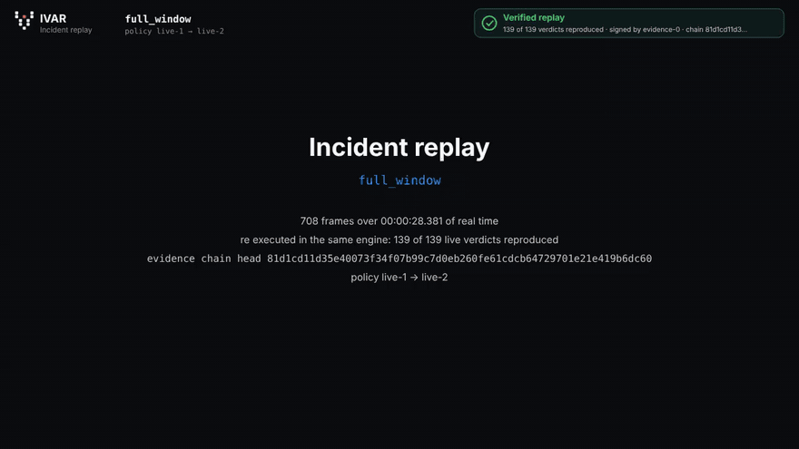
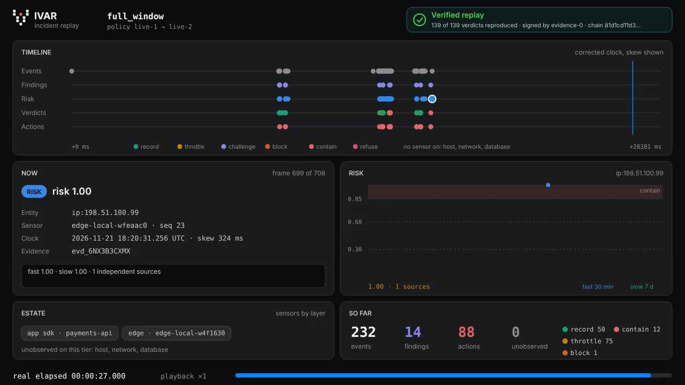

# IVAR: intent bound defence against agentic intrusion

An implementation of the design specification *Intent-Bound Defence Against
Agentic Intrusion*. The core model is a live graph of trust edges between
identities, workloads and data; detections, risk and every response act on
those edges, and irreversible actions only execute with a valid intent chain.

## The live test, replayed

[](docs/media/live-test-replay.mp4)

**[Watch the full replay (MP4, 32 s)](docs/media/live-test-replay.mp4)**

A real Express payments API behind Envoy, Coraza with the OWASP Core Rule Set
and the IVAR edge filter, attacked live (`deploy/live`). In 23.6 seconds of
real time: legitimate customers, a signed switch from observe to enforce with
no restarts, a credential spray (throttled), an account takeover and a
mass assignment privilege escalation (refused), a payout without an intent
chain (refused), a time locked payout (held), decoy hits (contained), a
victim lockout attempt and a shared network neighbour (both protected), then
control plane and core outages. 34 of 34 checks passed.

The video is not a screen recording: it is the signed ReplayBundle built from
the run's sealed evidence (`ivar-core replay`), re executed in the same engine
(135 of 135 verdicts reproduced, 0 unobserved intervals) and rendered frame by
frame (`scripts/export-replay.cjs`). Any incident exports the same way.

## The console

The console (`replay-viewer/`, served by the core at `/console/` when
`console_dir` is set) shows a verified replay or follows a live core.

| | |
|---|---|
| [](docs/media/console-live-overview.png) | [](docs/media/console-live-sessions.png) |
| **Overview**: KPIs, activity over time by decision, highest risk entities, rules fired, sensor health, integrity | **Sessions**: what each session sent (→) and received (←), with IVAR findings, verdicts and actions (◆) in line |
| [](docs/media/console-live-events.png) | [](docs/media/live-test-replay.mp4) |
| **Events**: every frame, searchable and filterable; the inspector shows the request and response with each field checked against the declared schema, the decision chain from event to receipt, the sealed evidence and the raw JSON | **Full screen replay** and **MP4 export**: the same renderer, so what you watch is what the video holds |

* **Live mode** polls the core's sealed evidence and re verifies the whole
  hash chain on every update; a record that does not link halts the view, an
  unreachable core is retried.
* **Replay mode** checks the bundle signature and evidence chain, then re
  executes every event in the browser before anything renders.
* Playback moves one cursor through every view; *As of playhead* limits every
  view to what had happened by then. Links carry filters
  (`#/events?decision=contain&entity=ip:198.51.100.7`), exports are CSV,
  JSON and MP4, and keys are `1` to `5` (views), `j`/`k` (frames), space,
  arrows, `F` (full screen) and `Esc`.
* Payload values never leave the sensor (section 16): the console shows field
  names, routes, statuses, keyed hashes and decisions, and says so.

## Layout

| Path | What it is | Language |
|---|---|---|
| `proto/ivar/v1` | Data contracts: events, entities, findings, risk, verdicts, actions, envelopes, ingest | Protobuf |
| `crates/ivar-contracts` | Contract types, signed policy bundles, ReplayBundle, crypto agile signing | Rust |
| `crates/ivar-core` | Trust fabric, declared intent compiler, eight detection methods, risk, Cedar policy, response ladder, safeguards, intent binding (Biscuit), invariants and time locks, evidence chain | Rust |
| `crates/ivar-replay` | Deterministic replay, counterfactual replay, attack replay library runner | Rust |
| `crates/ivar-server` | Core service (`ivar-core`): HTTP and gRPC ingest, operator API, sinks, responders | Rust |
| `crates/ivar-edge-filter` | Proxy-Wasm edge filter for Envoy, Istio, Kong, APISIX, NGINX | Rust to Wasm |
| `crates/ivar-wasm`, `crates/ivar-abi` | The same core compiled to WebAssembly for every SDK | Rust to Wasm |
| `crates/ivar-plugin-host` | Signed plugins: cosign, wasmi sandbox, process plugins, lifecycle, drift | Rust |
| `crates/ivar-ai` | AI layer with autonomy levels A0 to A3 and guardrails | Rust |
| `crates/ivar-sensor-kit` | Shared sensor runtime; Falco, Tetragon and Suricata adapters | Rust |
| `sensors/*` | Linux and Windows host agents, network, database, AI gateway, log collector, workstation, build runner | Rust |
| `sdk/*` | Application SDKs: Node (Express), Python (ASGI, WSGI), Go, Java, PHP (Laravel), .NET | Mixed |
| `go/` | Control plane (`ivar-control`: policy build, TUF, signed flags, plugin registry, rollout) and connectors (`ivar-connector`: cloud, identity, Kubernetes, telco, indicators, responders) | Go |
| `config/` | `security.config.ts`: the hardening configuration with the section 15 settings and fixes F1 to F9 | TypeScript |
| `plugins/` | Responder manifests, including the specification's `okta-responder` unchanged | YAML |
| `replay-library/` | Attack replay library: incidents and attacks on the IVAR itself | YAML |
| `replay-viewer/` | Operator console: verified replays and live mode, events, sessions, entities, graph, full screen replay, MP4, CSV and JSON export | JS and Wasm |
| `deploy/` | Dockerfile, Helm chart, Compose service, Terraform modules, Envoy config, policy source, operator decisions, local stack | Mixed |

## Quick start

```bash
scripts/build-wasm.sh                 # core to WebAssembly for the SDKs and viewer
cargo test --workspace                # Rust
deploy/local/up.sh                    # core, control plane, upstream, Envoy with the IVAR filter
python3 deploy/local/smoke_test.py    # end to end through real Envoy
deploy/local/up.sh down
```

Replay any incident from sealed evidence, then export it as a video (the
bundle is verified before a frame is drawn):

```bash
ivar-core replay --evidence data/evidence-0.jsonl --policies data/policies-0 --keyring keyring.json --redaction keys/redaction.hex --signer keys/evidence-0.seed --out replay.json
node scripts/export-replay.cjs replay.json keyring.json keys/redaction.hex replay.mp4
```

With Coraza and the OWASP Core Rule Set ahead of the IVAR filter:

```bash
CORAZA_WASM=/path/to/coraza-proxy-wasm.wasm deploy/local/up.sh && python3 deploy/local/smoke_test.py
```

A live test: installs from the release images in front of a real Express
payments API using the SDK, then runs legitimate traffic and an attack
campaign (credential spray, account takeover, mass assignment, payout
without intent, time locked payout, decoys, victim lockout, shared
networks), forensics (incidents, evidence chain, signed replay re verified
by a third party) and resilience (control plane down, core down, restart):

```bash
CORAZA_WASM=/path/to/coraza-proxy-wasm.wasm deploy/live/up.sh && python3 deploy/live/attack.py
deploy/live/up.sh down
```

Adding the SDK to an Express app (section 8.2):

```js
import { ivar } from '@ivar/express';
app.use(ivar({ mode: 'observe', identity: (req) => req.user?.id }));
```

## How a request is decided

1. A sensor builds an OCSF event with the `ivar` extension and redacts
   payloads and identifiers with a keyed hash before anything leaves it.
2. The sensor's local fast path decides known attacks from its last signed
   policy in about a millisecond; everything else is forwarded.
3. The core correlates the event on the trust graph, runs the eight methods,
   and scores each entity on two timescales (30 minute and 7 day half lives)
   with rule family maxima and independent sources.
4. Risk bands (0.30, 0.60, 0.85) pick a rung on the seven level ladder; every
   automatic action passes the safeguards (blast radius budget split by
   confidence class, protected entities, shared networks never banned, two
   source rule, per rule circuit breaker, evidence first, reversal, actor not
   target) and Cedar.
5. Evidence is sealed in a hash chain signed per shard, so any verdict can be
   replayed deterministically from its evidence and policy version.

DETECTION_MODE is signed runtime policy. A sensor blocks only when its own
mode and the verified policy both say enforce, so a sensor installed in
observe for rollout phase 1 never blocks, and a signed observe policy stops
every sensor from blocking with no deploy.

## Specification traceability

| Section | Where |
|---|---|
| 3, 4 Threat model and incidents | `replay-library/incidents/*.yaml`, one scenario per incident, all passing |
| 5 Principles | Crypto agility in `ivar-contracts/src/sign.rs`; reversible responses in `ivar-core/src/response` |
| 6.1 Trust edges | `ivar-core/src/trust` |
| 6.2 Intent binding | `ivar-core/src/intent` (Biscuit third party blocks per chain step), SDK `guard` calls |
| 6.3 Declared intent | `ivar-core/src/declare` (OpenAPI, IAM, Kubernetes, GitHub workflows, npm lockfiles, Terraform plans) |
| 7.1 Decision flow | `ivar-core/src/engine`, `ivar-core/src/sensor/fast_path.rs` |
| 7.2 Proven components | Falco, Tetragon, Suricata adapters in `ivar-sensor-kit/src/adapters`; Coraza ahead of the edge filter in `deploy/envoy` and the Helm chart |
| 8 Sensors | `crates/ivar-edge-filter`, `sdk/*`, `sensors/*`, `go/connectors/*` |
| 8.1, 8.2 Tiers and workflows | Helm chart, Compose service, Terraform modules, CI workflow in `deploy/` and `.github/workflows` |
| 9 Data contracts | `proto/ivar/v1`, `crates/ivar-contracts` |
| 10.1 Risk scoring | `ivar-core/src/risk` |
| 10.2 Worked example | `ivar-core/tests/worked_example.rs`, `replay-library/incidents/worked-example-10-2.yaml` |
| 10.3 Deception | `ivar-core/src/detect/deception.rs`, decoy tools in `sensors/ai-gateway`, canary secrets in `sensors/workstation` |
| 11.1 Safeguards | `ivar-core/src/safeguards` |
| 11.2 Failure behaviour | Fail open budget in `ivar-core/src/failure`; admin routes fail closed in every SDK and the edge filter; last signed policy kept on disk by every sensor |
| 12 AI layer | `crates/ivar-ai` (Claude Messages API and OpenAI compatible providers, guardrails, A0 to A3) |
| 13 Incident replay | `crates/ivar-replay`, `replay-viewer/` |
| 14 Plugins | `crates/ivar-plugin-host`, `plugins/` |
| 15 Policy and configuration | `config/src/security.config.ts`, `go/controlplane/build.go`, signed flags in `go/controlplane/flags.go` |
| 16 Securing the IVAR | Two key rule for weakening (`sign.rs`), TUF (`go/controlplane/tuf.go`), redaction (`ivar-core/src/redact.rs`), evidence chain (`ivar-core/src/evidence`) |
| 16.1 Attacks on the IVAR | `replay-library/self-defence/*.yaml`, `ivar-core/tests/self_defence.rs` |
| 17 Regional signals | `go/connectors/telco` (TIRMS, MTN Chenosis), `go/connectors/indicators` |
| 18 Performance | Latency budgets checked in the SDK tests (Node p99 0.02 ms, Java p99 0.52 ms) |
| 19 Rollout | Observe defaults everywhere; phase exit tests in the Helm NOTES |
| 20.1 Integration points | SDK middleware and action sinks, gateways, identity, CAEP, SIEM and OTel sinks, approvals, admission webhook, AI gateway, secrets, cloud audit, databases, telco, payment rails |
| 21 Open decisions | `deploy/policy/operator-decisions.yaml`, enforced by `ivar-control build` |
| Appendix A, F1 to F9 | `config/test/defects.test.ts`, one test per defect with the review's own input |

## Operating it

* **Keys.** `ivar-core keygen` writes a seed; `ivar-core keyring` builds the
  keyring from seed files (the key id is the file name). Policy changes that
  weaken protection need two named policy keys; the control plane refuses
  to sign them with one, and every sensor refuses a forged one.
* **Policy.** `ivar-control validate` loads the policy in the core and runs
  the attack replay library; `ivar-control build` signs it. Reference
  `operator-decisions.yaml` from `policy.yaml`; the build refuses
  unconfirmed decisions.
* **Operators.** The core's operator routes trust `X-Ivar-Operator`,
  `X-Ivar-Roles` and `X-Ivar-Hardware-2fa` from the staff SSO proxy in front
  of it. Do not expose those routes without that proxy.

## Verified here, and what was not

Verified in this repository's test suites and the local stack:

* Rust, Node, Python, Go, Java, PHP and .NET test suites.
* Envoy 1.33 running the IVAR filter, with and without Coraza and the
  Core Rule Set: observe, live signed rollout, enforcement, refusal of a
  forged one key weakening, and enforcement through a control plane outage.
* The core image running under the Compose file with a real signed bundle.
* The live test (`deploy/live`): the release images in front of a real
  Express API, 34 of 34 checks, reproduced on clean installs, with the
  console following it live from the core and the replay video above built
  from its sealed evidence.
* The Helm chart rendered with Helm's template engine and checked
  (`deploy/helm/chartcheck`), and the reference Envoy config accepted by
  `envoy --mode validate`.

Not verified here, so test them in your environment before relying on them:

* The Windows agent is type checked against the Windows target but has not
  run on Windows.
* Cloud, identity provider and telco connectors are tested against recorded
  API shapes, not live tenants. TIRMS access needs a licence.
* The Helm chart has not been installed on a cluster, and the Terraform
  modules have not been planned or applied (no `helm` or `terraform` binary
  was available).
* The sensors image could not be built in this environment because its
  package mirror was unreachable; its binaries build in the shared stage.
* No load test at production scale, no external security review, and the
  indicator network has not had the legal review section 17 requires.
